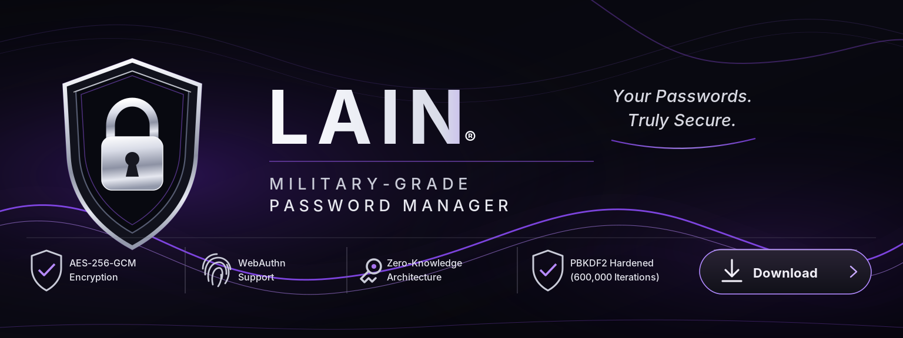

<p align="center">
  
</p>

# Lain

**A minimal, local-first password manager for Windows.**

Lain stores your accounts in an encrypted vault beside the application. It does not require a cloud account or a hosted service to create, unlock, or use the vault. You control the application files, the encrypted vault, and your backups.

<p align="center">
  <a href="https://github.com/hellzerg/lain/releases/download/4.0/Lain-4.0.exe" target="_blank">
    
  </a>
</p>

## Features

- Local encrypted vault with no account or cloud synchronization requirement.
- AES-256-GCM authenticated encryption for account fields.
- Master-password protection with automatic PBKDF2 work-factor upgrades.
- Optional FIDO2 security keys, with **Either** and **Both** unlock modes.
- Recovery code support for the second factor in Both mode.
- Password generator, favorites, tags, search, and account metadata.
- Ready for Post-Quantum cryptography transition.
- Automatic locking, configurable clipboard clearing, and optional start-with-Windows behavior.
- Security report for weak, reused, and old passwords, with an optional online breach check.
- Keyboard shortcuts for common account actions.

## Requirements

- Windows.
- .NET Framework 4.8
- For FIDO2 security-key support, the Windows WebAuthn API must be available. Lain requires WebAuthn API version 4 or later; the application reports Windows 10 22H2 or Windows 11 as supported environments for this feature.

Lain uses Windows CNG (`bcrypt.dll`) for AES-GCM and the Windows WebAuthn API for security-key operations. The application targets .NET Framework 4.8 and is not a cross-platform application.

<center>
<h2> ☕ Buy me a delicious espresso</h2>
</center>

## Unlock modes and master-password policy

Lain supports three modes:

| Mode | Unlock requirement | Minimum master-password length |
|---|---|---:|
| Password only | Master password | 15 Unicode scalar values |
| Either | Master password **or** an enrolled security key | 15 Unicode scalar values |
| Both | Master password **and** a security key, or the master password **and** the recovery code | 12 Unicode scalar values |

The password must also receive a **Strong** or **Very strong** result from Lain's offline strength estimator. Lain does not require arbitrary uppercase/lowercase/digit/symbol combinations; long passphrases are accepted. The estimator checks common passwords, repetition, predictable sequences, and related patterns. It is a local heuristic, not a guarantee that a password has never appeared in a breach.

The policy is enforced when creating a vault, changing the master password, enabling security keys, or switching modes. Existing passwords remain accepted for unlocking so a policy change does not unexpectedly lock out an existing vault; choose a compliant password when changing the password or a policy-sensitive setting.

The password KDF is PBKDF2-HMAC-SHA-256. New password-derived keys use **600,000 iterations** and a fresh 16-byte random salt. The 64-byte derived output is separated into a 32-byte AES key and a 32-byte HMAC key. Existing iteration counts are validated before derivation and are never reduced; the accepted maximum is 10,000,000 iterations.

After a successful password-based unlock, older password KDF settings are upgraded to at least 600,000 iterations:

- **Password-only:** Lain generates a new random salt, derives a new data key, re-encrypts the account fields, verifies the replacement vault, and then replaces the old vault. The master password itself does not change.
- **Either / Both:** Lain retains the random vault data key and re-wraps the password slot using a fresh salt and the target work factor. A pure KDF re-wrap does not require changing account ciphertexts. Both mode still requires the password plus its second factor.
- **Either, security-key-only unlock:** The password is not available during that login, so the password-slot upgrade is deferred until the next password-based login or a security-key management action that confirms the master password.
- Existing work factors above 600,000 are preserved rather than downgraded. The recovery-code KDF is separate and is not changed by the master-password KDF upgrade.

## Cryptographic design

### Current vault format: `LAINVLT4`

The current vault uses a versioned data section inside the `LAINBOX1` container. The container has a data section and an optional security-key section; each section retains its own integrity protection.

| Component | Current value | Purpose |
|---|---|---|
| Vault data format | `LAINVLT4` | Current data-section version |
| KDF identifier | `1` — PBKDF2-HMAC-SHA-256 | Password-based key derivation |
| AEAD identifier | `2` — AES-256-GCM | Authenticated field encryption |
| KEM identifier | `0` — none | No public-key key-encapsulation mechanism is enabled |
| Password salt | 16 random bytes | Per-vault password derivation salt |
| Default PBKDF2 work factor | 600,000 iterations | Current baseline for password-derived protection |
| File authenticator | HMAC-SHA-256, 32 bytes | Authenticates the complete serialized data section |

Each encrypted account field is independently authenticated with AES-256-GCM. Its Base64 representation contains a field-version byte, a fresh 12-byte nonce, the ciphertext, and a 16-byte authentication tag:

```text
0x03 | nonce[12] | ciphertext[N] | tag[16]
```

The field-version byte is included as associated data. Nonces are generated with the Windows cryptographic random-number generator. The 64-byte PBKDF2 output is split into separate AES-256 and HMAC-SHA-256 keys. The HMAC protects the complete serialized data section in addition to the per-field GCM tags.

The security-key section has its own authenticated `LAINKEY2` format. The outer container itself does not replace the integrity checks on either section. Unknown KDF, AEAD, or KEM identifiers are rejected; Lain does not silently fall back to a weaker algorithm when it encounters an unknown suite identifier.

AES-GCM is implemented through Windows CNG because the application targets .NET Framework 4.8, which does not include the newer managed `AesGcm` API. The implementation configures the CNG AES provider for GCM mode and uses a full 128-bit authentication tag.

### Security-key wrapping and recovery

Security-key mode uses a random vault data key and a separate random secret shared by the enrolled security-key configuration. The password slot, key-path slot, recovery slot, and each authenticator's PRF-derived wrapping path protect the material needed to reopen the same vault data key.

New security-key wrapping writes use AES-256-GCM. The versioned wrapping envelope remains able to read older CBC-plus-HMAC wrapped values stored inside a current `LAINKEY2` file. Lain opportunistically re-wraps older values when the corresponding factor is available. WebAuthn PRF outputs are not persisted, so a wrapping value that requires another authenticator can only be upgraded when that authenticator is next used.

A recovery code is generated from 30 random symbols using a Base32-style alphabet and displayed in groups of five. Store it somewhere separate from the computer and vault backup. In Both mode, the recovery code is an alternative second factor used together with the master password; it does not replace the password.

## FIDO2 / WebAuthn security keys

Lain uses the Windows WebAuthn API with the relying-party ID `lain.local` and the WebAuthn `hmac-secret` / PRF extension. Credentials are non-discoverable; their credential IDs and public-key metadata are stored in the authenticated security-key section.

The current build applies a strict policy:

- New registrations advertise **ES256 only** (`alg = -7`), using an EC2 public key (`kty = 2`) on P-256 (`crv = 1`).
- Registration and assertion request a cross-platform authenticator, intended for roaming security keys rather than Windows Hello platform credentials.
- User verification is required. A compatible authenticator may require a PIN or biometric check in addition to user presence.
- Registration validates the RP ID hash, user-presence, user-verification and attested-credential-data flags, credential-ID consistency, COSE key shape, and P-256 public-key validity.
- The `LAINKEY2` file stores each credential's ES256 public key. Every assertion is checked against the requested credential ID and RP ID, its authenticator data is validated, and its ES256 signature is verified locally before the PRF output is accepted.
- Malformed authenticator data, unexpected algorithms, invalid public keys, missing public keys, unknown credential IDs, and invalid or oversized signatures fail closed.
- Lain requests no attestation. It validates the public key and assertions but does not identify or certify the authenticator's manufacturer or model.

**Compatibility:** This build accepts `LAINKEY2` only. `LAINKEY1` files and credentials without stored ES256 public keys are rejected; there is no legacy signature-verification bypass and no automatic `LAINKEY1` migration. If you have a development profile created by an earlier build using `LAINKEY1`, use that earlier build to turn security keys off before configuring keys in this build. Do not manually delete `Lain.keys` or the security-key section of `Lain.vault`.

ES256 is classical elliptic-curve cryptography, not post-quantum cryptography. WebAuthn security-key signatures are therefore not quantum-resistant.

## Password-file parsing and input limits

`LAINKEY2` is treated as untrusted input until its structure and authentication are validated. The parser applies explicit bounds before processing fields:

| Field | Limit |
|---|---:|
| Serialized key file | 128 KiB |
| Enrolled credentials | 32 |
| Key name | 200 UTF-16 code units / 800 UTF-8 bytes |
| Credential ID | 1–1,023 bytes |
| PRF salt | Exactly 32 bytes |
| P-256 X/Y coordinates | Exactly 32 bytes each |
| Wrapped slot string | At most 256 canonical Base64 characters |
| Key-file PBKDF2 counts | 1,000–10,000,000 iterations |

The parser also requires strict UTF-8 and canonical bounded string-length encoding, rejects truncated or trailing data, rejects duplicate credential IDs and control characters in labels, validates P-256 points, validates date values and checks that the password/recovery/key slots are consistent with Either or Both mode. Enrollment and rename operations apply the same label restrictions so the application does not write key files that its own parser would reject.

The structural checks do not replace authentication: the security-key file's HMAC must still verify before a wrapped secret is trusted.

## Privacy and network behavior

Vault creation, unlocking, editing, and local storage do not require a cloud account or a remote vault service. The encrypted vault resides in the local `Data` directory and remains under the user's control.

The optional **breach check** is the feature that sends password-derived information to an external service. It uses the Have I Been Pwned Pwned Passwords range API with k-anonymity:

1. Lain computes each password's SHA-1 hash locally. SHA-1 is used only for compatibility with this lookup protocol; it is not used for vault encryption or authentication.
2. Only the first five hexadecimal characters of each hash are sent to `api.pwnedpasswords.com` over HTTPS.
3. The service returns a padded set of matching hash suffixes. Lain checks the full suffix locally.
4. The password and complete SHA-1 hash are not sent by this feature.

The breach check is optional and requires an internet connection. The application also has a user-triggered update check that fetches version information from the Lain GitHub repository and, if the user accepts an update, downloads the release executable. These network features are separate from vault storage and unlock.

## Keyboard shortcuts

| Shortcut | Action |
|---|---|
| `Ctrl+Q` | Copy the selected account's username/email |
| `Ctrl+W` | Copy the selected account's password |
| `Ctrl+E` | Open the selected account's link |
| `Ctrl+F` | Focus the search box and select its contents |
| `Delete` | Delete the selected account(s), when the search box is not focused |
| `Enter` | Edit the selected account, when the search box is not focused |
| `Ctrl+N` | Create a new account |
| `Ctrl+L` | Lock Lain immediately |
| `Ctrl+O` | Open Options |
| `Ctrl+D` | Add/remove the selected account(s) from Favorites |
| `Ctrl+R` | Open the account security analysis |
| `Esc` | Clear the search box, or return focus to the account list when it is empty |

## Downloads, source, and license

- Published binaries: [GitHub Releases](https://github.com/hellzerg/lain/releases)
- Source repository: [github.com/hellzerg/lain](https://github.com/hellzerg/lain)
- License: [GNU General Public License v3.0](LICENSE)
